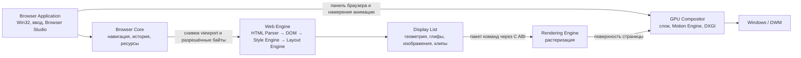

# Архитектура независимого браузера для Windows 11

Первая цель — собственный просмотрщик локального HTML с GPU-композицией. Он должен доказать путь **HTML → DOM → Style → Layout → Display List → кадр** и дать базу для измерений. Параллельно отдельный прототип Motion Engine должен проверить, удаётся ли менять геометрию видеослоя на Windows, пока его источник продолжает выдавать кадры. Эти две проверки можно провести до реализации HTTP, JavaScript и мультимедиа.

Решение для первого этапа: **Rust для семантики веб-страницы, состояния браузера и интерфейса; C++ для работы с графическим устройством, растеризации и композитинга. Один бэкенд — D3D11 с DXGI flip model.** Это выбор для команды из двух человек и Windows 11. Он не предполагает превосходства D3D11 над Vulkan по скорости. Браузер строится без Chromium, Gecko, WebKit, Servo и WebView; шрифты, графические примитивы, кодеки и HTTP/TLS можно доверить библиотекам общего назначения. Совместимость с современным вебом при собственных HTML, CSS, JS и изоляции — многолетнее направление, сроки которого нельзя выводить из скорости первого MVP.

## Локальный MVP 0.1

Один процесс для сборки разработчика, одно нативное окно, одна страница. Браузер открывает встроенные примеры и один явно выбранный доверенный файл HTML в UTF-8. Можно прокручивать длинную страницу, переходить по якорям и между встроенными примерами, возвращаться назад. Для тестовых страниц поддерживается PNG из списка встроенных ресурсов. Открытый пользователем файл не получает автоматического доступа к соседним файлам, UNC-путям или сети.

Поддерживаемое подмножество фиксируется до реализации: заголовки, абзацы, блоки, переносы строк, текст ссылок и изображения. Свой CSS Parser, селекторы по тегу, классу и ID, наследование базовых текстовых свойств, специфичность и порядок правил, блочная геометрия, простые поля и фон. Для MVP допускается текст одного стиля в абзаце с переносом строк, включая кириллицу; смешанные стили внутри строк, сложное направление текста и полное CSS inline layout — отдельные задачи. Неподдерживаемые конструкции имеют задокументированное поведение. Минимальный Browser Studio даёт выбрать положение панели, цвет акцента и длительность перехода или выключить анимации; изменения вступают в силу без перезапуска и сохраняются.

Демонстрация считается готовой, когда она воспроизводимо собирается на Windows 11 x64, одни и те же примеры дают ожидаемые DOM, геометрию и кадры, а resize, прокрутка и повторные переходы не приводят к падению или пустому кадру на проверенных конфигурациях. Для испорченного или слишком большого файла есть понятный отказ с сохранением предыдущего кадра. Для релизной сборки записаны базовые измерения запуска, навигации и памяти. Работа с публичными сайтами, JavaScript, видео, PiP, множеством вкладок и редактором тем находится за пределами этого MVP. Демонстрация Motion Engine поставляется отдельно от просмотра страниц.

## Границы модулей и потоков



| Владелец | Что ему принадлежит | Что он отдаёт соседям |
|---|---|---|
| **Browser Application / Browser Core**, Rust, поток UI | HWND и обработка сообщений Windows, ввод, профиль, история, текущий документ, доверенные панели и решения о доступе к ресурсам. Чтение файлов выполняется вне потока UI. | Запрос на загрузку или layout с ID документа и поколением viewport, команды управления окном и композицией. |
| **Web Engine**, Rust, рабочий поток документа | HTML Parser, DOM, CSS Parser, Style Engine, Layout Engine и геометрия для hit testing. Один владелец изменяемого DOM; ID узлов действуют только в своём документе. | Неизменяемый снимок: Display List, геометрия попадания, поколение документа и viewport. Дерево DOM остаётся внутри модуля. |
| **Rendering Engine / GPU Compositor**, C++, поток рендера | Графическое устройство, контекст D3D11, swap chain, текстуры и порядок вывода. Motion Engine вычисляет матрицы и прозрачность слоёв по монотонному времени. | Статус отправки кадра, ошибки устройства и метрики. Композитор не выполняет сетевые запросы и не меняет DOM. |

Поток UI не ждёт GPU или layout. Поток документа отменяет устаревшие задачи; композитор может пропускать промежуточные полные снимки страницы, но команды жизненного цикла ресурсов идут в порядке. При resize/DPI меняется поколение viewport: запоздавший результат отбрасывается, предыдущая готовая поверхность остаётся видимой до замены. При навигации кадр страницы, её идентификатор, адрес в панели и карта попаданий переключаются согласованно. Старый кадр не принимает клики за новый документ. Для перехода между origin по умолчанию меняем страницу и доверенный адрес вместе: снимок старой страницы не должен появляться под адресом новой. Ошибки открытия, парсинга и устройства доходят до владельца, который может их обработать.

**Display List — контракт для параллельной работы.** В нём достаточно прямоугольника, клипа, серии глифов и изображения. Координаты логические, порядок рисования задан, ресурсы адресуются через ID с оговорённым сроком жизни. DPI применяется один раз на границе вывода; браузерное масштабирование впоследствии будет отдельной настройкой layout. Один и тот же список принимает тестовый потребитель без GPU и нативный рендерер. Для прокрутки MVP меняет смещение и область видимости; может понадобиться заново растеризовать видимую область, но пересчёт layout не нужен. Текстуру высотой во всю страницу не выделяем.

DirectWrite решает задачи шрифтов. В MVP отдельный CPU-интерфейс на C++ разбивает простой абзац заданной ширины на строки, измеряет их и формирует глифы. Rust располагает абзацы и прочие блоки; команды рисования используют те же позиции глифов и идентификаторы шрифтов, что и при измерении. Так рендерер не пересчитывает геометрию текста. При реализации полноценного inline layout правила CSS, перенос между фрагментами разных стилей и построение строк реализуем в Rust; DirectWrite будет предоставлять метрики и формировать глифы. Для тестов геометрии используем фиксированные метрики, для интеграции — согласованный системный шрифт. [DirectWrite](https://learn.microsoft.com/en-us/windows/win32/directwrite/direct-write-portal), [получение глифов через пользовательский текстовый рендерер](https://learn.microsoft.com/en-us/windows/win32/directwrite/how-to-implement-a-custom-text-renderer).

## Почему D3D11 на первом этапе

Начальный путь: Win32 HWND, D3D11 и одна swap chain с DXGI flip model. Direct2D можно использовать для растеризации текста и 2D-примитивов в поверхности D3D11. Собственными остаются Display List, перевод его команд в графические примитивы, выбор областей для рисования, сцена, порядок слоёв и итоговая композиция. Direct2D и DirectWrite не знают о HTML, CSS или браузерных правилах рисования. WARP полезен как программный бэкенд D3D11 для offscreen-проверок, но не проверяет производительность видеодрайвера. [DXGI flip model](https://learn.microsoft.com/en-us/windows/win32/direct3ddxgi/for-best-performance--use-dxgi-flip-model), [совместная работа Direct2D и D3D11](https://learn.microsoft.com/en-us/windows/win32/direct2d/direct2d-and-direct3d-interoperation-overview), [WARP](https://learn.microsoft.com/en-us/windows/win32/direct3darticles/directx-warp).

Для Windows это сокращает число задач первого этапа: окно, вывод и типографика тестируются на одном стеке; впоследствии у Media Foundation есть путь декодирования в поверхности D3D11. Vulkan даёт явное управление ресурсами и переносимость графического слоя, но потребует отдельной интеграции с окном, синхронизации, памяти, текста и видео. Выгоду для нашего 2D-сценария надо показать профилем. Оставляем нейтральным Display List и протокол слоёв. Общую GPU Abstraction для двух бэкендов проектируем только при подтверждённой потребности. [Vulkan WSI](https://docs.vulkan.org/guide/latest/wsi.html), [D3D11-декодирование в Media Foundation](https://learn.microsoft.com/en-us/windows/win32/medfound/supporting-direct3d-11-video-decoding-in-media-foundation).

Один поток владеет immediate context и вызывает Present; UI продолжает обрабатывать сообщения Windows и при остановке рендера. Resize согласуется с владельцем swap chain: ссылки на старые back buffers освобождаются до их замены. Текстуры страницы и видео принадлежат сцене и живут отдельно от swap chain. Ресурсы переиспользуются после завершения работы GPU; при потере устройства сцена восстанавливается из состояния на CPU. В простое и при свёрнутом окне непрерывного рендера нет. При анимации композитор ориентируется на готовность очереди вывода и монотонные часы, без фиксированного таймера на 16 мс. [Потоки D3D11](https://learn.microsoft.com/en-us/windows/win32/direct3d11/overviews-direct3d-11-render-multi-thread-intro), [DXGI и цикл сообщений](https://learn.microsoft.com/en-us/windows/win32/direct3ddxgi/d3d10-graphics-programming-guide-dxgi), [DXGI 1.3](https://learn.microsoft.com/en-us/windows/win32/direct3ddxgi/dxgi-1-3-improvements), [Per-Monitor DPI](https://learn.microsoft.com/en-us/windows/win32/hidpi/high-dpi-desktop-application-development-on-windows).

## Motion Engine, Browser Studio и Adaptive UI

В Motion Engine Browser Core решает, разрешён ли переход и когда меняется логическое состояние. Композитор отвечает за то, как готовый слой проходит между двумя прямоугольниками. Пересчёт layout допустим для конечного состояния, например при изменении viewport или применении `:fullscreen`; он не должен происходить на каждом кадре анимации. Прерванный переход разворачивается из текущего положения. Отключение анимации в системе или браузере переводит слой в целевое состояние сразу.

Для fullscreen сначала проверяем преобразование внутри окна, затем безрамочный режим на том же HWND. Композитор удерживает рабочую текстуру и получает следующие кадры независимо от смены размера буферов вывода. При переходе между мониторами источник и цель переводятся в общую систему координат, учитываются смена DPI, изменение доступного экрана и потеря фокуса. Цель — около 220 мс по умолчанию, но фактический показ зависит от DWM, дисплея и драйвера. Если смена границ окна стабильно пропускает кадры, можно оставить анимацию внутри окна или выполнить мгновенный переход при подтверждённом resize; результат измерения определит решение.

В настоящем браузере сайт получает свои клавиатурные события и сам вызывает Fullscreen API. Browser Core проверяет пользовательскую активацию и применимые политики, поддерживает выход и состояние, видимое странице. Promise и события следуют алгоритму API, анимация не добавляет к ним искусственную задержку. После синтетического прототипа следующий шаг — локальный клип с настоящим декодированием и проверкой непрерывности аудио/видео. Для PiP потребуется отдельное окно и проверка передачи видеоповерхности между окнами, в том числе на разных адаптерах. Для YouTube также нужны JS, DOM/Web APIs, сеть, MSE, кодеки, аудио и синхронизация, в отдельных сценариях защищённое видео. Успех синтетического прототипа докажет только жизнеспособность композиции. [Fullscreen API](https://fullscreen.spec.whatwg.org/), [Picture-in-Picture](https://www.w3.org/TR/picture-in-picture/).

Browser Studio управляет декларативной конфигурацией доверенного UI: версионированная схема, набор допустимых компонентов и действий, токены цвета и размеров, параметры анимаций. Сначала одна перестановка панели и несколько токенов; Minimal, Glass и Terminal в будущем становятся пресетами этой же схемы. Не нужен второй HTML-движок для интерфейса. Marketplace и пользовательские компоненты со скриптами требуют отдельной модели разрешений. Adaptive UI позже может передавать в браузер только проверенный цветовой акцент, с opt-out, проверкой контраста и без влияния на признаки происхождения и доверия. Сайт не получает доступ к интерфейсу браузера через тему.

## Риски и решения, которые лучше принять заранее

| Риск | Почему он критичен | Что делаем |
|---|---|---|
| Совместимость HTML/CSS разрастается быстрее, чем фичи | Обработка ошибочной разметки, каскад, inline layout, bidi, fallback и размеры изображений взаимозависимы. | Разделяем tokenizer и tree builder по [HTML Standard](https://html.spec.whatwg.org/multipage/parsing.html), описываем подмножество [CSS Cascade](https://www.w3.org/TR/css-cascade-5/) и фиксируем поведение тестами. Сначала повторяемое подмножество, затем отдельные наборы возможностей. |
| Граница Rust/C++ становится дорогой и хрупкой | Вызов на каждый объект, общий аллокатор, скрытые копии и обратные вызовы на горячем пути ведут к ошибкам и задержкам. | Один пакет команд на снимок, отдельные пакетные операции для ресурсов и текста. Типы и владение проверяются на границе. Не держим блокировку UI во время отправки кадра. |
| Изоляция появляется после HTTP или JS | Сетевой ответ и медиа уже недоверенны без скриптов; Rust не изолирует процесс и не защищает C++ или системный декодер. | Архитектура брокера сейчас, проверенный sandbox и IPC до публичных адресов; fuzz-тесты парсеров с первого подмножества. |
| GPU даёт высокий средний FPS, но видны рывки | Resize, очередь Present, загрузка текстур и DWM могут задержать один критический кадр. | Измеряем распределение времени показов, проверяем смену окна отдельным прототипом, разделяем поверхность видео и буферы вывода. |
| Большая кастомизация блокирует основу | Свободное описание компонентов порождает отдельную платформу, расширяет поверхность атаки и усложняет доступность. | Небольшая схема конфигурации и независимый слой интерфейса. Ввод с клавиатуры, контраст и системная настройка анимаций проверяются вместе с темами. |
| JavaScript и видео превращаются в скрытый критический путь | Интерпретатор, модель объектов, GC, задачи/microtasks и Web APIs нужны задолго до полноценного стриминга. | Отделяем небольшой интерпретатор от DOM и тестируем его независимо. JIT, DRM и поддержка YouTube не входят в критерии раннего релиза. |
| Два разработчика ждут друг друга | Контракт layout/renderer и решения по ресурсам принадлежат сразу обоим. | В первую неделю договариваемся о минимальном Display List и примерах. Каждый работает со своей тестовой реализацией границы. Любое изменение контракта проверяют оба. |

## Модель безопасности до первого выхода в сеть

В MVP объём входного файла, глубина вложенности, число узлов, размер команды рисования и объём декодированных пикселей ограничены. Начальные пределы для калибровки: до 2 МиБ входного HTML, 10 000 узлов и глубина 128. Скрипты, обработчики событий и внешние ресурсы не исполняются и не загружаются. Сырые файлы остаются на входе Resource Management; движок получает байты разрешённого ресурса. Rust-код парсеров по умолчанию безопасный, а fuzz-тесты ищут падения, чрезмерную глубину и случаи, где вход вызывает несоразмерное потребление памяти или времени.

До загрузки произвольного URL выделяем **Browser Process** как брокер и **Web Content Process** как ограниченный процесс для страницы. Кандидат на Windows — AppContainer без сетевых capabilities, с явным списком наследуемых дескрипторов; Job Object дополняет его лимитами и управлением жизненным циклом. Обязательно проверяем попытки читать личные файлы, открывать сокет и создавать дочерний процесс, а также падение рабочего процесса и восстановление вкладки. После перехода на недоверенные ресурсы их декодирование тоже идёт вне привилегированного процесса. GPU в первом опыте можно оставить на доверенной стороне: он получает только проверенные команды с известными ID и лимитами размеров. IPC принимает данные как недоверенные, проверяет размеры, теги, поколения и права, а общую память использует только после защиты от изменений между проверкой и использованием. [AppContainer](https://learn.microsoft.com/en-us/windows/win32/secauthz/appcontainer-isolation), [Job Objects](https://learn.microsoft.com/en-us/windows/win32/procthread/job-objects).

Сеть, cookies, хранилище, разрешения и доверенная панель адреса контролируются брокером или отдельной доверенной службой. Страница не получает дескрипторы чужих ресурсов и не решает, какому origin принадлежит запрос. Для HTTP(S) учитываем схему, хост и порт; локальный документ получает отдельный непрозрачный origin. Сначала один изолированный контекст на origin; политика повторного использования процессов и полноценная site isolation вводятся по мере появления вкладок и встраиваемых документов. Допуск произвольных URL зависит от реальных проверок изоляции и брокера, а не от того, что у приложения формально несколько процессов. [WHATWG URL](https://url.spec.whatwg.org/), [Fetch Standard](https://fetch.spec.whatwg.org/).

## Контракт Rust и C++

- **Сборка.** Один Cargo workspace и один вход сборки. Rust stable с целью Windows x64 MSVC, C++20 и Windows SDK. Cargo вызывает MSVC через `cc` в одном `build.rs`, нативная часть линкуется статически. CMake стоит добавлять при появлении отдельного нативного продукта или зависимости, которой он необходим. Версии toolchain и прямых зависимостей закрепляются после первой воспроизводимой сборки. Для Win32 в Rust подходит `windows`; оба крейта имеют варианты MIT и Apache-2.0. [Rust for Windows](https://learn.microsoft.com/en-us/windows/dev-environment/rust/rust-for-windows), [windows-rs](https://github.com/microsoft/windows-rs), [cc-rs](https://github.com/rust-lang/cc-rs).
- **Поверхность ABI.** Один канонический C-заголовок и тонкая безопасная Rust-обёртка над ним. Операции: создать и завершить сессию, изменить viewport, загрузить или освободить ресурс, отправить пакет сцены, получить статус; CPU-сервис текста отделён от сессии GPU. Используем C ABI, структуры с явной раскладкой (`repr(C)` в Rust), целые фиксированного размера, числовые теги, непрозрачные дескрипторы и массивы «указатель + длина». Размеры, выравнивание и теги проверяются тестом с обеих сторон. Версия и размеры структур позволяют отклонить несовместимый интерфейс. Через границу не проходят C++ классы, COM-объекты, Rust-коллекции и исключения. [Rust Nomicon: FFI](https://doc.rust-lang.org/nomicon/ffi.html).
- **Владение и ошибки.** Кто выделил память, тот её освобождает. Входные массивы заимствованы только на время вызова; если C++ сохраняет команды для следующего кадра, он переносит данные в свой буфер. Вызов выполняется на потоке рендера после передачи снимка из Rust, поэтому копия не блокирует UI. Возврат через коды статуса, с различием между неверными данными, временной невозможностью вывода и потерей устройства. C++ перехватывает исключения на границе; Rust не разматывает стек через ABI. Нативная сессия привязана к своему потоку, ресурсы закрываются средствами RAII. Zero-copy вводится только для измеренного узкого места и после определения срока жизни буфера.
- **IPC — отдельный контракт.** Содержимое Display List переиспользуется по смыслу, но представление C ABI с указателями никогда не передаётся между процессами. Формат IPC использует длины, смещения и ID ресурсов, имеет версию и ограничения на число команд. Брокер проверяет координаты, клипы и принадлежность ресурсов документу; веб-слой не может рисовать вне своей области, выбирать GPU-операции или ссылаться на текстуры интерфейса.

## Сложность подсистем

Оценки ниже относятся к инженерной сложности, а не к проценту готовности. Ориентир для двух разработчиков, знакомых с Rust и Win32/D3D: **8–12 календарных недель на локальный MVP**, включая прототипы и интеграцию. Это первоначальная оценка при работе обоих полный день; после трёх прототипов её нужно пересмотреть по фактическим трудозатратам.

| Подсистема | Сложность и главный источник работы |
|---|---|
| Foundation: сборка, окно, логирование, CI | Средняя. Сборку и offscreen-тесты можно автоматизировать сразу; интерактивные GPU-прогоны нужны отдельно. |
| Browser Core и Resource Management | Средняя для локального документа. Высокая для вкладок, отмены запросов, восстановления процессов, истории и управления памятью. |
| HTML Parser и DOM | Средняя для заданного подмножества. Высокая для ошибок разметки по стандарту, мутаций DOM, парсинга во время загрузки и взаимодействия со скриптами. |
| CSS Parser и Style Engine | Средняя для простых правил. Очень высокая для каскада, вычисленных значений и точной инвалидации при изменениях. |
| Layout Engine и текст | Высокая даже для качественного вывода текста. Очень высокая для inline layout, переноса сложных письменностей, Flexbox/Grid и инкрементального пересчёта. |
| Rendering Engine и GPU Compositor | Средняя для нескольких примитивов. Высокая для кешей, тайлов, экономной композиции, прозрачности и восстановления устройства. |
| Network Stack | Средняя для ограниченного HTTP(S) поверх библиотеки. Высокая для браузерных политик, редиректов, cookies, кеша, прокси и безопасности загрузок. |
| JavaScript Runtime и Web APIs | Очень высокая. Ядро языка, объекты, GC и задачи — отдельный пласт; DOM bindings, события, Fetch, таймеры и Promises должны согласоваться с ним. |
| Motion Engine | Средняя для анимации управляемого слоя. Высокая для переключения вкладок и окон, работы вместе с медиапайплайном и поведения при отмене. |
| Browser Studio и Adaptive UI | Низкая для ограниченной схемы настроек. Высокая для свободной компоновки, доступности, редактора, импортируемых пакетов и скриптов. |
| Мультимедиа, fullscreen и PiP | Очень высокая в связке с сайтами. Декодирование — лишь часть задачи; нужны доставка потока, часы аудио/видео, буферы и смена поверхностей. |
| Sandbox, IPC и site isolation | Очень высокая. Требуются определённые полномочия брокера, проверка негативных сценариев, управление процессами и ограничение ресурсов. |
| Тесты, совместимость и профилирование | Средняя для базового стенда. Постоянная работа по мере расширения поддерживаемого стандарта и матрицы GPU/DPI. |

## Roadmap и работа вдвоём

| Этап из ТЗ | Зависимости и критерий перехода | Разработчик A | Разработчик B |
|---|---|---|---|
| **Phase 1 — Foundation**, недели 1–2 | Согласованный Display List и тестовая сцена. Воспроизводимая сборка и первый кадр в окне. | Контракт и фикстуры, HTML tokenizer, тестовый потребитель команд. | Win32, сборка Rust/C++, DXGI, прототип 1. |
| **Phase 2 — HTML Prototype**, ориентир недели 2–4 | Прототип 2 даёт ожидаемую геометрию; вывод его Display List через бэкенд из прототипа 1. | HTML Parser, DOM, блоки, ссылки и подстановка ресурсов. | Растеризация текста, PNG через [Windows Imaging Component](https://learn.microsoft.com/en-us/windows/win32/wic/-wic-lh) для встроенных примеров, прототип 3 после прототипа 1. |
| **Phase 3 — CSS & Rendering**, до локального MVP на неделях 8–12 | Простейший каскад, resize, прокрутка, смена страниц, сохранение настроек и замеры. Полный inline layout, Flexbox и инкрементальный layout идут следующими срезами, если нужны. | CSS Parser и Style Engine, геометрия и hit testing, лимиты и fuzz-тесты. | GPU Compositor, интерфейс и минимальный Browser Studio, измерения. |
| **Phase 4 — Networking** | После локального MVP и проверки ограниченного процесса. Сначала локальный тестовый сервер, далее явный HTTPS и статический контент при прохождении проверок. | URL, политика ресурсов, отмена, редиректы, MIME и лимиты. | Запуск процессов и IPC, восстановление после падения, UX загрузки. |
| **Phase 5 — JavaScript** | Языковое ядро можно разрабатывать независимо. Связь с документом после появления изоляции, событий, времени жизни DOM и origin. | Lexer, Parser, AST и интерпретатор; далее модель объектов, GC, microtasks и DOM bindings. Bytecode VM после стабилизации семантики; JIT только по профилю. | Интеграция с циклом событий, проверка отзывчивости UI и границ процесса. |
| **Phase 6 — Advanced Experience** | Motion Engine начинается в Phase 2, Browser Studio — в Phase 3. Реальное видео и PiP зависят от медиа, Fullscreen API и нативных поверхностей. | Web APIs, семантика событий и сценарии совместимости. | Слои, анимации вкладок и навигации, расширение Browser Studio, нативное видео. |
| **Phase 7 — Compatibility & Security** | Совместимость расширяется итерациями. Sandbox, fuzzing и профилирование стартуют раньше и входят в критерии допуска. | Тесты платформы, стандарты, ресурсы и изоляция. | Кросс-адаптерные прогоны, диагностика, память и устойчивость композитора. |

Критический путь до MVP: **контракт → два независимых прототипа → интеграция HTML и GPU → CSS, UI и проверка**. Прототип 3 зависит от прототипа 1; DOM ему не нужен. До сетевого этапа один разработчик может проверять IPC и sandbox на фиктивном документе, пока другой расширяет Layout Engine. Распределение A/B — владельцы направлений, а не исключительное право редактировать их; оба ревьюят Display List, ABI и IPC.

Для первой сети достаточно проверяемого HTTP-клиента, например [reqwest](https://github.com/seanmonstar/reqwest) (MIT или Apache-2.0, документирован TLS через Windows при выборе соответствующего бэкенда). HTTP, TLS и сертификаты не реализуем с нуля. Браузер задаёт доверие к сертификатам, перенаправления, размеры после распаковки, таймауты и отмену. Cookies, полноценный кеш, авторизация и subresources добавляются после тестов политики. До выхода из экспериментального режима не включаем функции только ради совместимости с конкретным сайтом.

## Монорепозиторий

Структура 0.2 заимствует у Chromium деление на приложение, платформу контента, сеть, графику и переиспользуемые компоненты. Имена наших модулей сохранены. [Навигация по исходникам Chromium](https://www.chromium.org/developers/how-tos/getting-around-the-chrome-source-code/), [Content module](https://chromium.googlesource.com/chromium/src/+/main/content/README.md).

```text
/
  Cargo.toml                       # общий workspace
  Cargo.lock
  rust-toolchain.toml
  ARCHITECTURE.md
  browser/
    browser_app/                   # Win32, адресная строка, брокер страницы
    browser_core/                  # навигация и история
  content/
    web_engine/
      src/
        html_parser.rs
        dom.rs
        css_parser.rs
        style_engine.rs
        layout_engine.rs
    web_content_process/           # HTML, CSS, изображения и layout в AppContainer
  net/                             # Network Stack, HTTP(S), URL и политика ресурсов
  components/
    browser_studio/                # схема и хранение настроек
  gpu/
    display_list/                  # Rust-модель и проверка инвариантов
    rendering_ffi/                 # обёртка и сборка C++
    rendering_engine/
      include/                     # канонический C ABI
      src/
        motion_engine/
  testing/
    fixtures/                      # HTML, CSS, изображения и ожидаемая геометрия
  .github/
    workflows/
```

`web_engine` и `display_list` не зависят от Win32 и C++. `rendering_ffi` переводит Display List в ABI. Приложение загружает HTML, а отдельный Web Content Process возвращает список объявленных ресурсов. Брокер скачивает разрешённые CSS и изображения, выдаёт процессу страницы метрики DirectWrite и проверяет итоговые команды и пиксели перед передачей в GPU. Windows CI проверяет сборку, Rust-тесты, ABI и offscreen-вывод WARP.

## Первые три технических прототипа

1. **Нативное окно и путь Rust → C++ → GPU.** B, ориентир 5–7 рабочих дней. Нативный цикл событий, одна тестовая сцена из Rust, клип и цветные прямоугольники через ABI, вывод D3D11. Критерий: чистая сборка на Windows 11 x64; изображение совпадает с ожидаемым; resize, сворачивание, смена DPI и закрытие повторяются без зависания. Offscreen WARP проверяет сборку и базовые пиксели, отдельный запуск на реальной видеокарте — вывод. Замерить старт и путь от отправки списка до Present, сохранить характеристики машины.
2. **Локальный HTML до проверяемого Display List.** A, 5–8 рабочих дней, стартует вместе с первым. Несколько UTF-8 фикстур, включая кириллицу, неверную разметку и длинную страницу: tokenizer, маленькое DOM-дерево, блочная геометрия, текст с тестовыми метриками. Критерий: тесты сравнивают DOM, геометрию и список команд без GPU; превышение лимитов даёт ошибку; первая фикстура выводится на экране через контракт прототипа 1 без адаптации DOM к D3D.
3. **Motion Engine: живая текстура от элемента до fullscreen и обратно.** B, 4–7 рабочих дней после прототипа 1. Синтетический источник выдаёт кадры с ID и метками времени. Композитор масштабирует их в окне, затем проверяет вход/выход из безрамочного fullscreen на том же HWND. Критерий: источник не перезапускается, анимация не вызывает layout, нет видимой пустой поверхности в серии из 30 переходов на контрольной конфигурации. Отдельно проверить быстрое переключение, resize и изменение DPI. Снять интервалы фактического вывода на 60 Гц и, при наличии монитора, на 120/144 Гц; отметить паузы при смене окна отдельно от стабильной анимации. Запись изображения проверяет вспышки, трейс — тайминг. Если безрамочная смена режима портит серию, оставить воспроизводимый внутриоконный вариант и выделить проблему нативного вывода в отдельное решение. Нативный декодер и YouTube этот опыт не проверяет.

## Как измерять прогресс

Начать с локальных сценариев в release-сборке: первый показ окна, открытие короткого и длинного файла, непрерывная прокрутка, серия resize, переход слоя. Отдельно записывать холодный и тёплый старт, время от события ввода до первого соответствующего кадра, длительность разбора, layout и рисования, память процесса и объём выделенных графических ресурсов. Указывать машину, драйвер, DPI, разрешение, режим питания и частоту дисплея. Для повторяемых серий сохранять медиану, p95/p99 и пропуски кадров; средний FPS скрывает отдельные рывки. [PresentMon](https://github.com/GameTechDev/PresentMon) помогает с таймингом вывода на Windows. Отправленный в очередь Present ещё не означает появление изображения на экране.

Один период дисплея — около 16,67 мс при 60 Гц, 8,33 мс при 120 Гц, 6,94 мс при 144 Гц, 6,06 мс при 165 Гц и 4,17 мс при 240 Гц. Для сравнения конфигураций считаем также интервалы вывода в долях периода. Первые прогоны дают базу; цели по пропускам и задержке устанавливаем для конкретного сценария и железа. С появлением вкладок добавим тесты переключения, выгрузки и роста памяти, с появлением фоновой активности — измерения нагрузки и энергии в простое и при воспроизведении. Кеши, инкрементальный layout, арены, отложенную инициализацию и фоновые пулы добавляем там, где измерения показывают цену и выигрыш.

Для совместимости подключаем выбранные группы [Web Platform Tests](https://web-platform-tests.org/) по мере реализации соответствующих возможностей, для языка — [Test262](https://github.com/tc39/test262). [Speedometer](https://browserbench.org/Speedometer3.1/) проверяет сценарии веб-приложений; запуск имеет смысл после появления требуемых DOM, JS, CSS и событий. Сравнение с существующими браузерами корректно только для одинаковых сценариев и сопоставимой функциональности.
